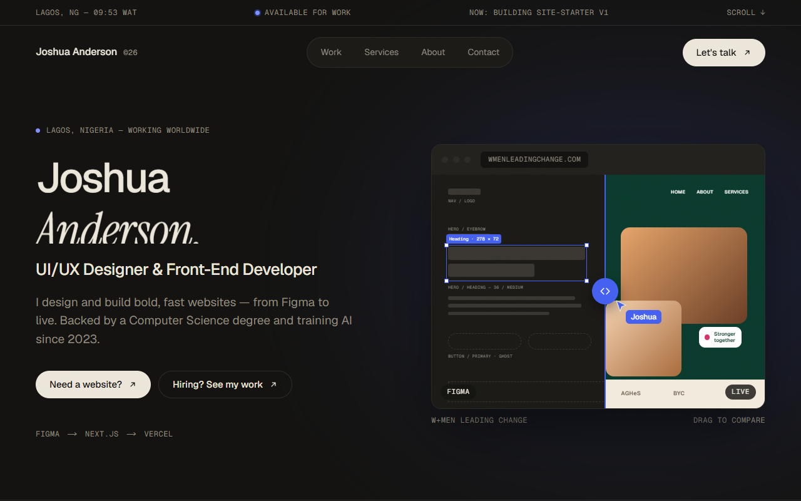

# Joshua Anderson — Portfolio

Portfolio site for Joshua Anderson, a UI/UX designer and front-end developer in Lagos. It speaks to two audiences at once: freelance clients ("Need a website?" → Services) and employers ("Hiring? See my work" → Work).



## Pages
- **Home**: name hero with a Figma ↔ live compare slider, featured work, services, short about, contact band
- **Work** (`/work`): every project as a card, filterable by Web, UI/UX, Graphic design and System
- **Case studies** (`/work/[slug]`): MDX pages with process steps, figures and the compare slider
- **Graphic design** (`/graphic-design`): masonry gallery with an accessible lightbox
- **Services** (`/services`): services, process steps and a "Get a quote" band (WhatsApp + form)
- **About** (`/about`): story, experience and education timeline, grouped skills, CV download
- **Contact** (`/contact`): form, email, WhatsApp, LinkedIn, GitHub and availability

## Stack
Next.js 16 (App Router, Cache Components) · React 19 · TypeScript · Tailwind CSS v4 · MDX · lucide-react · Vercel

## Getting started
```bash
npm install
npm run dev
```
Open http://localhost:3000. Other scripts: `npm run lint`, `npm run build`, `npm run start`.

## Editing content
- **Copy, projects, services, experience, skills, links**: `src/config/site.config.ts`. Components never hardcode content.
- **Case studies**: `src/content/work/<slug>.mdx`, then set `hasCaseStudy: true` on the project in the config.
- **Images**: `public/images/` (gallery flyers in `public/images/graphics/`); the CV lives at `public/cv/`.
- **Design tokens**: colours, type, radius, spacing and motion in `src/styles/tokens.css`; fonts in `src/styles/fonts.ts`.
- **Share image**: generated from the config and tokens by `src/app/opengraph-image.tsx`.

Projects marked `status: "coming-soon"` show only a generic title and an abstract cover: no client name, screenshot or link until the client approves publication.

## Accessibility and motion
Semantic landmarks, skip link, visible focus, AA contrast, keyboard-operable slider, filters and lightbox. Scroll reveals, hover scaling, the cursor bubble and the slider nudge all switch off with `prefers-reduced-motion`.

Lighthouse on a local production build: 100 accessibility, best practices and SEO; performance 99 on desktop and roughly 85–94 on mobile.

## Deploy
Import the repo at [vercel.com/new](https://vercel.com/new); no settings are needed. Canonical URLs, the sitemap and share cards use Vercel's production URL automatically. For a custom domain, set `NEXT_PUBLIC_SITE_URL` (for example `https://your-domain.com`) in the project's environment variables and redeploy.

The contact form's server action (`src/components/sections/contact.action.ts`) validates input but doesn't send mail yet. Fill in its `TODO` with Resend or Formspree to deliver messages.

## License
MIT. See [LICENSE](LICENSE).
